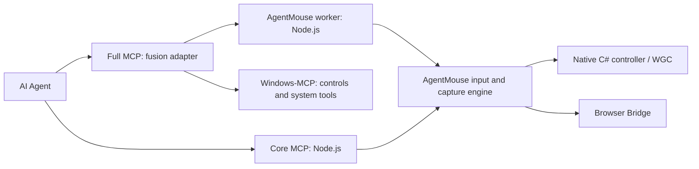

# Modules and editions

> 当前有未解决的微信卡死事件。请保持已安装插件禁用，不对真实微信重试。防护补丁默认关闭 UIA，移除任意 PowerShell，并将 Full 调整为 26 个工具；这是临时隔离，尚未证明根因修复。详见 [事件记录](incidents/2026-11-04-wechat-hang.md)。

AgentMouse Core 是可独立运行、构建、安装和测试的产品。AgentMouse Full 在 Core 的稳定输入接口上加适配层，不修改 Core 的鼠标实现。

| 模块 | 位置 | 责任与边界 |
|---|---|---|
| AgentMouse 原生引擎 | `Core.cs`, `Native.cs`, `WindowCapture.cs`, `DesktopInventory.cs`, `Ui.cs`, `Transport.cs` | 独立指针、真实窗口采集、窗口消息输入、身份/旧帧/前台保护、用户启用/暂停；不引用 Python 或 Windows-MCP |
| Core MCP / 浏览器引擎 | `mcp-server.mjs`, `browser-*.mjs`, `bridge-*.mjs`, `browser-extension/` | 原生 11 工具、观察编号、浏览器页面输入/截图；不导入融合层 |
| Full 适配层 | `fusion-entry.mjs`, `fusion-worker.mjs`, `fusion/*.py` | MCP 工具组合、窗口局部标签与坐标映射、调用 Core、隔离控件查询、生命周期与取消；不自行注入系统鼠标 |
| 上游 Windows-MCP | `vendor/windows-mcp/` | 复用其控件树及系统工具；保留 MIT 许可和原始源码；不启动其物理输入控制器 |
| 分发与安装 | `scripts/install-lib.mjs`, `install-plugins.mjs`, `fusion-setup.mjs`, `build-release.ps1` | Core 只复制公共模块；Full 按需添加适配层及打包运行时 |
| Python 打包器 | `scripts/build-python-runtime.mjs` | 仅构建时需要 Python/uv；发布的 Full 已有隔离、可迁移的 Python 和锁定依赖 |

## 分发边界

- **Core ZIP**：11 工具，包含我们的 C#/Node/浏览器代码；没有融合 `.py`、Windows-MCP 源码、Python 运行时。
- **Full ZIP**：Core + Full 适配层 + Windows-MCP + 自带 Python。26 个工具名，其中共享键盘/批量输入兼容接口明确返回不支持。
- 两版默认加载各自引擎。安装器通过包内 `agentmouseEdition` 识别版本，不依赖用户猜参数。
- 两版使用同一插件标识，切换版本是更新同一插件；不会让两个鼠标服务同时争用输入。客户端刷新后生效。
- Core 能单独构建：`scripts/build-release.ps1 -Edition Core`，无需 Python/uv。构建 Full 才需要打包工具链。
- Full 安装会把 Python 运行时复制到用户自己的 AgentMouse 目录；安装后的服务不依赖解压目录、系统 Python、uv 或 Python 环境变量。

## 我们的工作与上游贡献

AgentMouse Core、后台浏览器通道、目标与观察保护、跨智能体安装器、插件与技能由本项目实现。Full 的接口融合、局部标签绑定、自带运行时与独立双包由本项目实现。Windows-MCP 提供其系统工具与 UIAutomation 树能力。上游源码按原许可证保留，并在 GitHub 语言统计中标为 vendored，不计入本项目的自有代码语言占比。

完整验证说明：[compatibility.md](compatibility.md)；Full 用法：[fusion.md](fusion.md)。微信邮箱、第三方 CAPTCHA 和独立键盘仍未获得完整业务验收。
