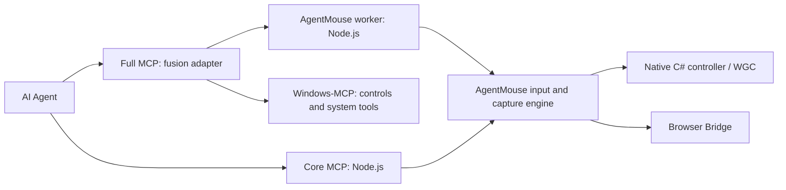

# Modules and editions

Codex 已通过安装后的 Full 插件完成一次后台恢复与首封邮件读取。最新构建的后续复测因应用退出登录停在登录页，具体版本和范围分别记录。[验收记录](test-results/codex-background-mail-2026-11-06.json)

AgentMouse Core 是可独立运行、构建、安装和测试的产品。AgentMouse Full 在 Core 的稳定输入接口上加适配层，不修改 Core 的鼠标实现。

| 模块 | 位置 | 责任与边界 |
|---|---|---|
| AgentMouse 原生引擎 | `Core.cs`, `ActivationGuard.cs`, `native/`, `Native.cs`, `WindowCapture.cs`, `DesktopInventory.cs`, `Ui.cs`, `Transport.cs` | 独立指针、真实窗口采集、原生输入保护、身份/旧帧/前台保护、启用与暂停 |
| Core MCP / 浏览器引擎 | `mcp-server.mjs`, `browser-*.mjs`, `bridge-*.mjs`, `browser-extension/` | 原生 11 工具、观察编号、浏览器页面输入/截图；不导入融合层 |
| Full 适配层 | `fusion-entry.mjs`, `fusion-worker.mjs`, `fusion/*.py` | MCP 工具组合、窗口局部标签与坐标映射、调用 Core、隔离控件查询、生命周期与取消；不自行注入系统鼠标 |
| 上游 Windows-MCP | `vendor/windows-mcp/` | 复用其控件树及系统工具；保留 MIT 许可和原始源码；不启动其物理输入控制器 |
| 分发与安装 | `scripts/install-lib.mjs`, `install-plugins.mjs`, `fusion-setup.mjs`, `build-release.ps1` | Core 只复制公共模块；Full 按需添加适配层及打包运行时 |
| Python 打包器 | `scripts/build-python-runtime.mjs` | 仅构建时需要 Python/uv；发布的 Full 已有隔离、可迁移的 Python 和锁定依赖 |

## 分发边界

- **Core ZIP** 包含 11 个工具、C# 控制器、原生保护库、Node 和浏览器模块。
- **Full ZIP**：Core + Full 适配层 + Windows-MCP + 自带 Python。26 个工具名，其中共享键盘/批量输入兼容接口明确返回不支持。
- 两版默认加载各自引擎。安装器通过包内 `agentmouseEdition` 识别版本，不依赖用户猜参数。
- 两版使用同一插件标识，切换版本是更新同一插件；不会让两个鼠标服务同时争用输入。客户端刷新后生效。
- Core 能单独构建：`scripts/build-release.ps1 -Edition Core`，无需 Python/uv。构建 Full 才需要打包工具链。
- Full 安装会把 Python 运行时复制到用户自己的 AgentMouse 目录；安装后的服务不依赖解压目录、系统 Python、uv 或 Python 环境变量。

## 我们的工作与上游贡献

AgentMouse Core、后台浏览器通道、目标与观察保护、跨智能体安装器、插件与技能由本项目实现。Full 的接口融合、局部标签绑定、自带运行时与独立双包由本项目实现。Windows-MCP 提供其系统工具与 UIAutomation 树能力。上游源码按原许可证保留，并在 GitHub 语言统计中标为 vendored，不计入本项目的自有代码语言占比。

完整验证范围见 [compatibility.md](compatibility.md)，Full 用法见 [fusion.md](fusion.md)。真实第三方 CAPTCHA、独立键盘和从未呈现到前台的冷渲染器仍待验收。

原生截图由同目录 CLI 的短生命周期进程执行；PNG 返回前关闭捕获资源。父控制器只保留图像散列和观察信息，不保留 GPU 捕获帧。暂停/超时直接结束自己启动的截图进程。Core 与 Full 共用同一实现，无需额外运行时或包内可执行文件。
# 前台、键盘焦点和层级诊断

## 通用原生输入与窗口恢复

`ActivationGuard.cs` 管理单次受保护操作的内存映射、进程创建时间和 UI 线程绑定。`native/activation-guard.c` 在目标线程中读取有期限的控制块，`native/activation-policy.h` 保持顶层窗口的前台与层级，`native/virtual-pointer.h` 提供位置、鼠标按键和命中窗口查询。键盘输入与真实指针由用户继续使用。控制器通过独立读取入口取得实际物理指针，避免自身输入监测被虚拟查询影响。

窗口关联来自 HWND 所属进程、`parentPid`、owner 和 UI 线程。应用内部子窗口可以正常布局与绘制。子窗口不会因顶层保护而被统一冻结。输入路由未包含应用名称或业务页面判断。

后台恢复读取应用实际调用 `Shell_NotifyIconW` 注册的回调、标识和协议，再与系统通知图标记录核对。唯一且可验证的入口才会触发恢复。不存在入口、协议不支持、窗口身份变化或多个入口不能消歧时，返回能力错误并保留现场。实现未包含邮箱菜单或特定应用版本。

`NIM_SETVERSION` 更新协议记录，删除图标后清理回调元数据。重放 `TaskbarCreated` 时，已有图标的重复添加可能失败，此时保留应用在该结构中声明的协议。声明与实际模式不一致的应用仍需兼容性验证。

原生 DLL 使用内容摘要文件名，载荷清单指定当前版本。后台应用仍引用旧 DLL 时，构建与安装不会覆盖它。保护在结束、取消和期限到达时失效，目标进程中的 DLL 引用保持到应用退出。跨位数、受保护进程、锁定桌面和所有软件的窗口消息兼容性仍有边界。

原生点击回执的 `focusChanged` 为旧兼容字段，仅表示操作前后 `GetForegroundWindow` 返回值不同。新增 `foregroundWindowChanged` 明确表达相同含义；`raisedAboveForeground` 单独报告目标是否越过原前台窗口。

`inputFocusBefore` / `inputFocusAfter` 记录前台线程的活动窗口和键盘焦点 HWND，不读取输入内容。只有采样前后前台一致、活动窗口匹配且焦点句柄有效时，`keyboardFocusKnown` 才为 true；否则 `keyboardFocusChanged` 为 null，不能解释为“没有变化”。`keyboardDeliveryTested=false` 表示没有通过实际打字验收输入去向。

操作前后的焦点回执需要与新截图及业务结果一并核对。它们记录端点状态，无法单独排除采样之间的瞬时变化。
